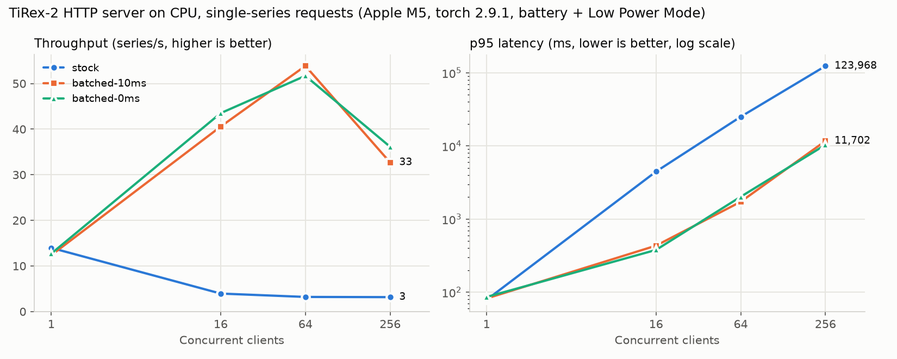

# Dynamic request batching for the TiRex-2 inference server

The TiRex-2 HTTP server ([NX-AI/tirex-2](https://github.com/NX-AI/tirex-2), `inference/`) runs one model call
per request; its README notes "There isn't any internal batching done". This adds server-side batching
without changing the API callers see.

## What changed

1. Concurrent forecast requests are held for up to `BATCH_MAX_WAIT_MS` (default 10 ms) or until `BATCH_MAX_SIZE` (default 256) series are waiting, run as one model call per `prediction_length`, and each caller gets back exactly its own forecasts.
2. `GET /metrics` serves Prometheus text: request count, batch-size histogram, queue wait, model latency, and p50/p95 end-to-end latency.
3. Same routes, request and response schemas; `BATCHING_ENABLED=0` restores one model call per request. A failing request is retried alone so it cannot fail its batch-mates.

## Where the code is

| Path | What |
|---|---|
| `upstream/` | Clone of NX-AI/tirex-2 at `dbcae91` with the patch applied (created by the first step under How to run) |
| `upstream/inference/app/batching.py` | New: `MicroBatcher` (collect, group by `prediction_length`, one model call, split back) |
| `upstream/inference/app/metrics.py` | New: hand-written Prometheus metrics and `/metrics` route |
| `upstream/inference/app/http_server.py` | Endpoints become `async` and `await predict(...)` instead of calling `model.predict(...)` |
| `upstream/inference/app/config.py`, `README.md` | Three settings and their docs |
| `tirex2-batching.patch` | The whole change as one patch against `dbcae91` |
| `tests/test_batching.py` | Routing, max size, max wait, error isolation, metrics format |
| `bench/benchmark.py` | CPU load test, stock vs batched; writes `bench/results.md`, `bench/results.json`, `bench/throughput_latency.png` |

The diff to upstream files is 26 added and 11 removed lines; everything else is in the two new modules.

## How to run

```bash
# upstream at the pinned commit, with this change applied
git clone https://github.com/NX-AI/tirex-2 upstream
git -C upstream checkout dbcae91
git -C upstream apply ../tirex2-batching.patch

# fresh venv (Python 3.13, CPU torch as in Dockerfile.cpu)
uv venv --python 3.13 .venv
grep -v '^tirex-2$' upstream/inference/requirements.txt > /tmp/req.txt
VIRTUAL_ENV=$PWD/.venv uv pip install --no-build torch==2.9.1 -r /tmp/req.txt \
  "flashrnn>=1.0.8" "xlstm~=2.0.3" PyYAML huggingface-hub narwhals pytest pytest-asyncio matplotlib
VIRTUAL_ENV=$PWD/.venv uv pip install --no-deps ./upstream

# batching checks (fake model, about 3 s)
.venv/bin/python -I -m pytest tests/test_batching.py -q

# the server, local only (downloads NX-AI/TiRex-2, about 380 MB, on first start)
HF_HOME=$PWD/.hf .venv/bin/python -I -m uvicorn app.http_server:app \
  --app-dir upstream/inference --host 127.0.0.1 --port 8000
curl -s localhost:8000/metrics

# upstream's own HTTP + MCP tests against that server
cd upstream/inference && TEST_START_SERVER=0 TEST_PORT=8000 ../../.venv/bin/python -I -m pytest tests/test_http.py tests/test_mcp.py -q

# benchmark (starts and stops its own servers on 127.0.0.1:8765)
HF_HOME=$PWD/.hf .venv/bin/python -I bench/benchmark.py --clients 1 16 64 256 --repeats 3
```

## Benchmark

Hardware: Apple M5, 10 logical CPUs, 16 GB RAM, macOS 26.5.2, Python 3.13.12, torch 2.9.1 (4 intra-op threads), CPU only. Upstream commit dbcae91.

Workload: closed-loop clients, each request = 1 univariate series of 512 points, prediction_length 32, `/univariate/forecast/mean`.

Each cell is the median over its runs (mode order rotated between repeats); the Series/s range is min-max over those runs.

| Server | Clients | Runs | Requests per run | Series/s | Series/s range | p50 latency | p95 latency | Series per model call |
|---|---:|---:|---:|---:|---:|---:|---:|---:|
| stock | 1 | 1 | 64 | 14.0 | 14.0-14.0 | 70 ms | 79 ms | 1 (by design) |
| stock | 16 | 1 | 64 | 3.9 | 3.9-3.9 | 4119 ms | 4461 ms | 1 (by design) |
| stock | 64 | 1 | 256 | 3.2 | 3.2-3.2 | 23941 ms | 25102 ms | 1 (by design) |
| stock | 256 | 1 | 1024 | 3.2 | 3.2-3.2 | 76526 ms | 123968 ms | 1 (by design) |
| batched-10ms | 1 | 2 | 64 | 12.4 | 12.3-12.5 | 80 ms | 82 ms | 1.0 |
| batched-10ms | 16 | 2 | 64 | 40.6 | 40.6-40.6 | 407 ms | 433 ms | 9.1 |
| batched-10ms | 64 | 2 | 256 | 53.9 | 53.2-54.6 | 1124 ms | 1725 ms | 25.9 |
| batched-10ms | 256 | 1 | 1024 | 32.7 | 32.7-32.7 | 6855 ms | 11702 ms | 9.8 |
| batched-0ms | 1 | 1 | 64 | 12.7 | 12.7-12.7 | 72 ms | 86 ms | 1.0 |
| batched-0ms | 16 | 1 | 64 | 43.5 | 43.5-43.5 | 364 ms | 378 ms | 8.0 |
| batched-0ms | 64 | 1 | 256 | 51.7 | 51.7-51.7 | 1121 ms | 2021 ms | 18.3 |
| batched-0ms | 256 | 1 | 1024 | 36.1 | 36.1-36.1 | 5449 ms | 10367 ms | 10.9 |



What the numbers say, and what they do not:

- At 1 client, batching costs nothing measurable beyond the window: about 80 ms vs 70 ms per request.
- From 16 clients on, the stock server gets slower as clients are added. Up to 40 request threads call the model at once and oversubscribe the CPU, so throughput falls from 14 to about 3 series/s. With batching it rises to 40-54 series/s at 16-64 clients, and p95 drops about 10x (433 ms vs 4.5 s at 16 clients; 11.7 s vs 124 s at 256).
- At 256 clients the batched numbers are held back by the load generator, not by the model. A model-free echo server with the same request shape tops out at 94 requests/s from this client at 256 connections (213 at 16). Requests therefore reach the batcher slowly, and batches average about 10 series. A separate client machine would show more.
- The model call releases the GIL about 91% of the time (measured with a pure-Python loop in a second thread), so the event loop is not starved while a batch runs.
- In two earlier pilot runs (1 and 16 clients, then 1 and 2 clients), batched forecasts were bit-identical to stock forecasts for the same inputs (max abs diff 0.0).
- Conditions: one laptop, client and server on the same machine, on battery with macOS Low Power Mode on. Absolute numbers will be higher when plugged in.
- Coverage: the full 3-repeat run stopped part-way through its second repeat. A benchmark-harness bug (a reused keep-alive connection) caused it, and it is fixed in `bench/benchmark.py`. The table aggregates the 15 completed runs, 1-2 per cell. Rerun the command above for all 3.

## Known limits

- One batcher per server process; run several uvicorn workers and each batches on its own.
- The queue is unbounded. Under sustained overload, requests wait instead of getting a 503.
- Endpoints are now `async`, so request parsing and `.tolist()` run on the event loop. That is cheap for single series and measurable for requests with hundreds of series.
- A request larger than `BATCH_MAX_SIZE` is never split; it runs as its own call, as before.
